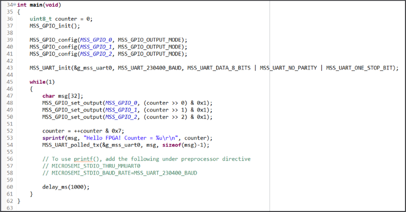
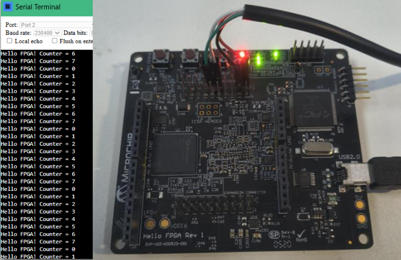

# HelloFPGA MSS UART Test Project

#### Description:

- Demonstrates MSS hard UART + blinky code for the HelloFPGA (SmartFusion2 - M2S010-VFG256) board
- UART and blink code in MSS. Fabric only routes to the IO pins.

#### Hardware:

- HelloFPGA
- USB to UART bridge

#### Demo:

  
  

------  